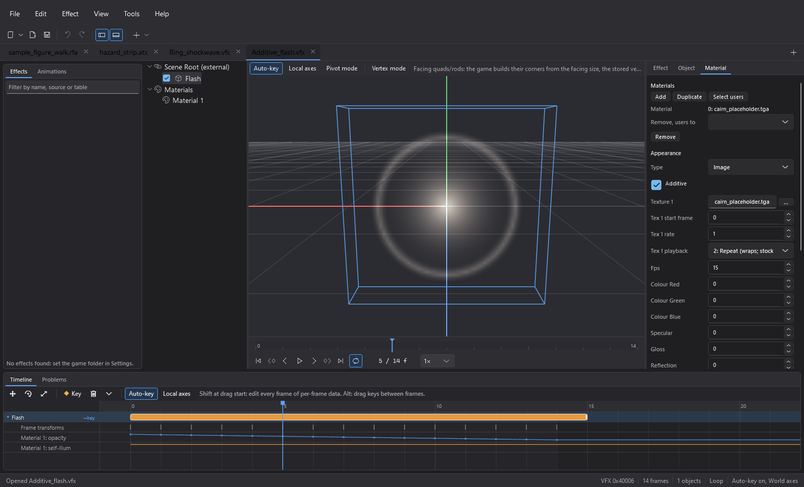

# Cairn

A Windows workbench for Red Faction modding. Open animated textures, animations and meshes, effects, packfiles,
tables, fonts, bitmaps, sounds and levels side by side in tabs, preview them the way the game plays them, edit them,
convert them, and catch what the game would get wrong before you load them. Built for
[Alpine Faction](https://alpinefaction.com) 1.0–1.5.

Cairn replaces ATX Workbench and RFA Workbench, and imports their settings on first run.



See the [usage guide](docs/USAGE.md) for how to do things in every module, and the [reference](docs/REFERENCE.md)
for menus, settings, problem codes and format limits.

## Formats

| Format | View | Edit | Save | Create | Notes |
|---|---|---|---|---|---|
| `.atx` animated texture | ✓ | ✓ | ✓ | ✓ | Alpine Faction 1.4+; also from a `.vbm` |
| `.rfa` animation clip | ✓ | ✓ | ✓ | ✓ | |
| `.v3c` character mesh | ✓ | ✓ | ✓ | ✓ | New from glTF |
| `.v3m` static mesh | ✓ | | Copy | ✓ | New from glTF |
| `.vfx` effect | ✓ | ✓ | ✓ | ✓ | Older versions convert before editing |
| `.vpp` packfile | ✓ | ✓ | ✓ | ✓ | |
| `.tbl` table | ✓ | ✓ | ✓ | ✓ | |
| `.vf` font | ✓ | ✓ | ✓ | | |
| `.vbm` bitmap | ✓ | ✓ | ✓ | ✓ | |
| `.wav` `.ogg` `.aif` sound | ✓ | | | | Convert to WAV or Ogg Vorbis |
| `.dds` image | ✓ | | | ✓ | DDS converter (from TGA, PNG, JPG) |
| `.tga` `.png` `.jpg` image | ✓ | | | | |
| `.rfl` level | ✓ | | | | Red Faction, Alpine Faction and Red Faction II; convert to glTF, OBJ, `.v3m`, `.rfg` |
| `.rfg` group file | ✓ | | | ✓ | Created by converting a level, mesh, glTF or OBJ; convert to glTF, OBJ, `.v3m` |
| `.obj` Wavefront OBJ | | | | ✓ | From meshes, levels and group files; import as `.v3m` / `.v3c`; convert to glTF or `.rfg` |
| `.v3d` `.vcm` exporter mesh | ✓ | | | | Convert to `.v3m` / `.v3c` |
| `.rfm` `.rfc` PS2 mesh | ✓ | | | | Convert to `.v3m` / `.v3c` |
| `.peg` PS2 texture pack | ✓ | | | | Convert to `.tga` (+ `.atx` for animations) |
| `.vse` `.vmu` PS2 sound | ✓ | | | | Convert to WAV or Ogg Vorbis |
| `.toc_group` `.packfile` Red Faction II packfile group | ✓ | | | | Preview, extract and convert the files inside |
| `.rfm` `.rfc` Red Faction II mesh | ✓ | | | | Convert to `.v3m` / `.v3c` or glTF |
| `.rfa` Red Faction II animation | ✓ | | | | Plays on its Red Faction II character; convert to a Red Faction `.rfa` or glTF |
| `.rfe` Red Faction II effect | ✓ | | | | Animated preview with its `.peg` textures; convert to a Red Faction `.vfx` |
| `.peg` Red Faction II texture pack | ✓ | | | | Textures for its levels and meshes; convert to `.tga` |

## Modules

- **Animated textures (ATX)**: visual and text editing kept in sync, an animated preview following the game's
  playback rules, frames from disk or packfiles, bulk timing, and VBM import.
- **Animations and meshes (RFA, V3C, V3M)**: engine-exact clip playback, a dope sheet, pose editing with gizmos and
  IK, clip tools, retargeting (single or batch), `.v3c` mesh editing, glTF import/export compatible with REDUX, and
  Wavefront OBJ import/export.
- **Effects (VFX)**: playback, an outliner, inspectors, a timeline, gizmos, vertex editing, particle preview, and
  creation from templates, primitives, meshes, other effects or glTF.
- **Packfiles (VPP)**: instant opening of any packfile, previews of everything inside, add/replace/rename/remove
  with undo, safe saving, checks against the game's limits, a one-line Info column, PS2 content conversion, and
  read-only Red Faction II packfile groups.
- **Tables (TBL)**: an editor that knows every stock and Alpine Faction table, with live checks, completion, hover
  docs, go to definition, find usages, previews of referenced files and compare with stock.
- **Fonts (VF)**: every glyph and sample text drawn as the game draws it, editing of glyphs, metrics and kerning,
  and PNG image sheet export/import.
- **Volition bitmaps (VBM)**: animated preview, a frame strip with drag, drop and paste, editing with undo, frame
  export, and conversion to ATX.
- **Sounds**: waveform and playback for PC and PS2 sounds, and conversion to WAV or Ogg Vorbis.
- **Levels & groups (RFL, RFG)**: read-only levels (Red Faction, Alpine Faction and Red Faction II) and editor group
  files with their facts and a 3D preview, and conversion to glTF, OBJ, static meshes and group files for Alpine
  Faction's level editor; meshes, glTF and OBJ files convert to group files too.

**File › Convert to…** lists every conversion Cairn offers for the file in front. Every module has live problem checks
against what the engine actually does, most with one-click fixes. Cairn also offers per-extension file associations,
light and dark themes, and crash recovery.

Red Faction II levels, meshes, animations, effects and packfile groups (`.toc_group`) are read only: Cairn previews, extracts
and converts them, and never writes them.

## Requirements

Windows 10 or 11, x64. The portable build needs nothing else; the framework-dependent build needs the
[.NET 9 Desktop Runtime](https://dotnet.microsoft.com/download/dotnet/9.0).

Cairn finds your Red Faction install through Alpine Faction's settings. Set the game folder and extra search folders
under **Tools › Settings…**.

## Building

Requires the [.NET 9 SDK](https://dotnet.microsoft.com/download).

```powershell
dotnet build Cairn.sln -c Release
dotnet test
.\publish.ps1                      # portable single-file build -> dist\
.\publish.ps1 -FrameworkDependent  # needs the .NET 9 Desktop Runtime
```

| Path | Contents |
|---|---|
| `src/` | Shared libraries and the `Cairn.Shell` application |
| `modules/` | One folder per module: core library, UI and tests |
| `native/vorbis/` | Prebuilt Ogg Vorbis encoder DLL; `build.ps1` rebuilds it from Xiph.Org's source |
| `tools/`, `samples/` | Icon and sample generators, and the generated samples |

Tests that need the game's files pass without them.

## License and credits

MIT; see [LICENSE](LICENSE). By Chris "Goober" Parsons. See the [changelog](docs/CHANGELOG.md) for release notes.

Uses [AvalonEdit](https://github.com/icsharpcode/AvalonEdit), [Tomlyn](https://github.com/xoofx/Tomlyn),
[NVorbis](https://github.com/NVorbis/NVorbis), [BCnEncoder.NET](https://github.com/Nominom/BCnEncoder.NET) and
Xiph.Org's [libvorbis and libogg](https://xiph.org/vorbis/); see [THIRD-PARTY-NOTICES.md](THIRD-PARTY-NOTICES.md).
Thanks to [rafalh](https://github.com/rafalh/rf-reversed), [wardd64](https://github.com/wardd64/UnityFaction) and
[natarii](https://github.com/natarii) for format research.
